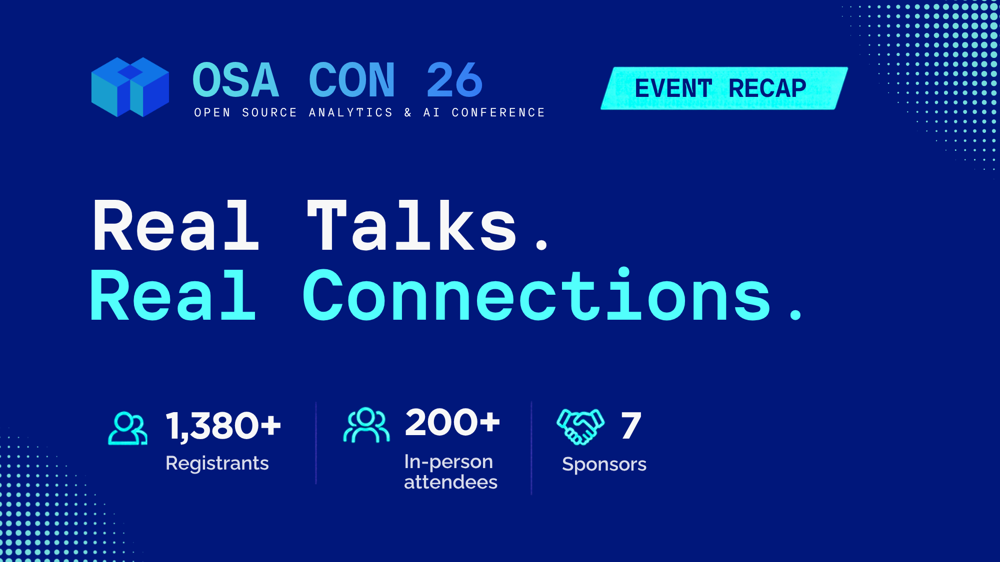
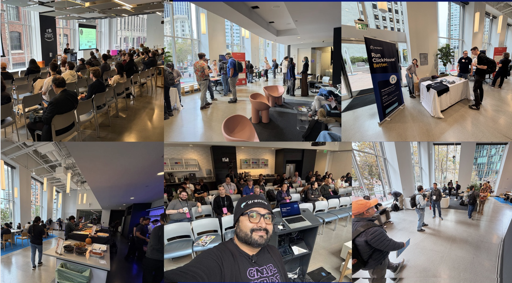

  

  

    <h1 style="font-size:2.5rem;">OSA CON 2026 Recap: Great Talks, Great Conversations, and an Incredible Community</h1>
    
By Ian Cook | December 31, 2025

    

      
    

  

After five years of bringing the open source analytics community together online, OSA CON went in person for the first time in 2026. And what an event it was!

Hosted at the AWS Builder Loft, OSA CON 2026 brought together developers, engineers, open source contributors, and industry leaders for a day of technical discussions, knowledge sharing, and meaningful connections.

Here's OSA CON 2026 by the numbers:

- 1,370+ registrants
- 200+ in-person attendees
- 26 Speakers
- 19 talks across 2 technical tracks
- 9 awesome sponsors supporting the open source community

But the numbers tell only part of the story.

## Great Talks. Terrific Hallway Conversations.

True to OSA CON's anti-hype theme, this year's agenda focused on practical engineering, real-world challenges, and lessons from the field, with technical sessions spanning agentic AI, database architectures, real-time analytics, open lakehouses, and the evolving open source ecosystem.

One of the best pieces of feedback was how much attendees loved the quality and depth of the technical agenda. One attendee even shared that the agenda was what convinced them to come in the first place.

And the sessions delivered what was promised. As attendees put it:

- "Every presenter had something of deep value to share."
- "Great talks, great vibe, great networking."
- "It was such a good mini conference. Got a lot out of it."

It's exactly the kind of experience we'll continue striving to create at future conferences and community meetups.

Just as memorable was the energy outside the sessions. We heard again and again how much people enjoyed the hallway conversations, networking, and overall vibe. People came for the talks, but also to exchange ideas, compare architectures, and connect with others tackling similar challenges.

After five years online, bringing everyone together in person felt especially meaningful. In a world increasingly shaped by AI, **human connection remains something technology can't replace.**

      

## It's All About the Community: The Reason We Host These Events

The Open Source Analytics Community exists because of you - the people in this community are incredibly smart and building incredibly cool things.

Getting to meet you, learn from you, and create spaces where ideas can be shared openly is one of the great privileges of working in developer communities.

**Open source thrives when people come together to share knowledge, challenge ideas, and build better technology.** OSA CON 2026 was a great reminder of that.

## Thank You!

A huge thank you to our speakers, panelists, seven sponsors, organizers, and everyone who attended, asked questions, and contributed to the conversations.

You made our first in-person OSA CON something special.

*Great technology brings us together. Great communities keep us connected.*

We can't wait to see you at the next OSA CON and at more community events along the way!

You can find our calendar of events at [https://osacom.io](https://osacom.io).

Find the recorded 2026 sessions here: [https://osacon.io/sessions/2026/](https://osacon.io/sessions/2026/)

<section class="py-5" style="
  background: white; max-width:900px;
">
  <h2 class="mb-4">OSA Con 2026 sponsors</h2>
  

    

      

        

          <h3 class="h4 pt-2 opacity-50">Platinum sponsors</h3>
          

            

            

          

        

      

      

        

          <h3 class="h4 pt-2 opacity-50">Diamond sponsors</h3>
          

            

          

        

      

      

        

          <h3 class="h4 pt-2 opacity-50">Gold sponsors</h3>
          

            

            

            

            

          

        

      

      

        

          <h3 class="h4 pt-2 opacity-50">Media partners</h3>
          

            

            

          

        

      

    

  

</section>
